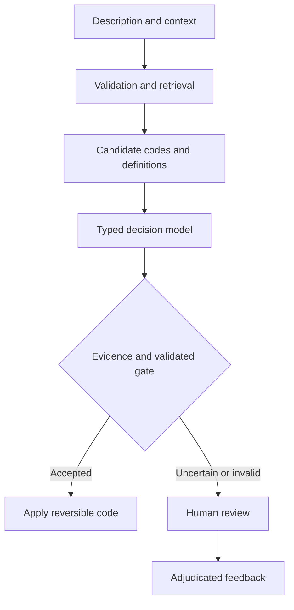

# System One Models Research Guide

**Jev, Laya, and practical workflows for bounded AI decisions**  
**Author:** Shaam Purushothaman Jayakumaran  
**Research snapshot:** 28 October 2026  
**Status:** Literature synthesis and proposed experiment design. No original benchmark results are reported.

This guide investigates when a typed decision model could improve a classification or matching workflow, what it would take to run one, and how to establish whether the added complexity is worthwhile. It consolidates four working documents into one public research reference. The main recommendation is to compare decision models with simple baselines on the same records and select an approach using error cost, review effort, deployment constraints, and measured performance.

System One models are attractive when applications need repeated, bounded judgments over language. A constrained answer space can simplify integration. It does not establish factual correctness, reliable uncertainty, or operational value. Those properties require separate evidence.

This is a public technical research guide, not a report of an employer deployment. All examples are illustrative. The repository should contain public or deliberately fabricated data only.

## Contents

1. [Research scope and evidence](#1-research-scope-and-evidence)
2. [What System One models do](#2-what-system-one-models-do)
3. [Models and alternatives](#3-models-and-alternatives)
4. [Benefits and tradeoffs](#4-benefits-and-tradeoffs)
5. [Administrative classification](#5-administrative-classification)
6. [Entity resolution](#6-entity-resolution)
7. [Historical case prioritization concept](#7-historical-case-prioritization-concept)
8. [Setup methods](#8-setup-methods)
9. [Question and response design](#9-question-and-response-design)
10. [Data and synthetic experiments](#10-data-and-synthetic-experiments)
11. [Training and adaptation](#11-training-and-adaptation)
12. [Evaluation and calibration](#12-evaluation-and-calibration)
13. [Cost and operational value](#13-cost-and-operational-value)
14. [Deployment and monitoring](#14-deployment-and-monitoring)
15. [Research roadmap](#15-research-roadmap)
16. [Public repository structure](#16-public-repository-structure)
17. [Sources and consolidation notes](#17-sources-and-consolidation-notes)

## 1 Research scope and evidence

The core questions are:

- Can typed decision models improve bounded judgments over short text or paired records?
- When do they add value beyond rules, conventional classifiers, and transformer encoders?
- How much data preparation, calibration, and infrastructure do they require?
- Can selective automation save reviewer time while meeting a defined error tolerance?

Evidence is separated into four categories throughout this guide:

| Evidence category | Meaning |
| --- | --- |
| Documented capability | A primary source describes an interface or supported operation; this is not an independent performance result. |
| Publisher result | A developer reports a benchmark or measurement under its own conditions. |
| Research recommendation | A proposed design or interpretation in this guide. |
| Unverified hypothesis | An expected benefit that needs an experiment. |

No model was downloaded, trained, or queried while preparing this guide. Setup examples are documentation-grounded starting points, not verified integrations. API names, checkpoints, packages, pricing, and desktop interfaces can change. Record exact versions when running an experiment.

## 2 What System One models do

TypeSafe uses the term System One for models that answer typed questions over supplied state. The terminology draws on fast System 1 thinking, but should not be treated as a standardized architecture or a claim about human cognition. Jev is TypeSafe's hosted implementation; Laya is a separately developed open-weight implementation. [S1, S2]

The application supplies the evidence, question, and allowed outcomes. A typed result then feeds application logic. For example, a support message can be mapped to billing, technical support, sales, or review. The output space is defined before inference. [S1, S3]

| Primitive | Intended decision | Example |
| --- | --- | --- |
| `choice` | Select among named alternatives | Select a department or administrative code. |
| `noul` | Estimate the probability of an affirmative judgment | Does the message request a refund? |
| `score` | Evaluate against ordered levels | Place urgency on an explicitly defined scale. |

The exact returned fields and score conventions belong to the serving implementation. Do not assume a score is a percentage or a confidence field is identical to the highest class probability. Inspect the response contract. [S3]

### A decision interface is different from a guarantee

A model can return an allowed category while misreading the evidence. An abstention option can also be selected incorrectly. Structured generation from a conventional language model can constrain output syntax too, so the comparison should examine decision quality and cost, rather than assuming that typed output alone is unique.

Language generation remains useful for drafting, summarization, and explanation. A decision model is worth considering when those outputs are unnecessary, or when another component already prepares the evidence. A model-generated explanation, if added, should be checked against source evidence independently.

## 3 Models and alternatives

| Approach | Access and control | Useful research role | Main tradeoff |
| --- | --- | --- | --- |
| Jev | Hosted TypeSafe API | Test a managed typed decision service | External service dependencies and processing terms need assessment. |
| Laya | Open weights and local serving | Test private inference and domain adaptation | The operator owns dependencies, serving, calibration, and maintenance. |
| Deterministic rules | Fully controlled application logic | Establish a transparent baseline | Rules become difficult to maintain for broad language variation. |
| TF-IDF plus linear classifier | Local supervised model | Establish a low-cost text baseline | Needs reliable labels and may miss semantic variation. |
| Encoder plus classifier or pair scorer | Local or hosted, depending on implementation | Compare semantic classification and matching | Requires task-specific design and evaluation. |
| Language model with structured output | Local or hosted | Compare instructions, difficult context, and richer evidence handling | Generation overhead and uncertainty estimation can complicate the workflow. |

Jev's API is the documented managed access route in the sources checked. An equivalent self-hosted offering is not established by those sources. Confirm current options directly before making a procurement or residency decision. [S1, S3]

Laya's model card identifies English, multilingual, and typed-decision variants. It also reports that default context budgets vary and warns about overconfidence and weak base-checkpoint performance on some typed-decision tasks. Check the precise checkpoint and input limits rather than treating the family as one interchangeable model. [S2]

API compatibility can reduce integration work. It does not make two models equivalent in probability interpretation, truncation, accuracy, or error handling. Keep provider-specific response adapters.

## 4 Benefits and tradeoffs

### Potential benefits

A finite answer space makes downstream validation easier. Questions can incorporate category definitions at inference time, making them useful for experiments with evolving taxonomies. Local execution may offer more control over processing, while a hosted service can reduce infrastructure work. These are design advantages; their financial value depends on workload and measured performance.

Publisher speed comparisons should be read as measurements under particular conditions. Model latency alone excludes retrieval, preprocessing, network calls, queueing, logging, and human review. No universal speedup or cost-saving figure is asserted here.

### Common failure modes

| Failure | Why it matters | Experiment or control |
| --- | --- | --- |
| Valid but wrong category | Schema compliance can conceal semantic errors | Inspect confusion patterns and serious mistakes. |
| Missing true candidate | The final selector cannot recover an excluded code | Measure retrieval recall separately. |
| Truncated evidence | A decisive fact may never reach the model | Record token budgets and truncation flags. |
| Overconfidence | A wrong decision can pass an automation gate | Evaluate calibration on held-out data. |
| Changing option wording | Small definition changes can alter decisions | Version questions and test paraphrases. |
| Novel input or domain shift | Historical performance may not transfer | Test new categories, time periods, and sources. |
| Instruction-like text inside records | A document may attempt to manipulate routing | Include adversarial text and enforce actions outside the model. |
| Weak labels | The experiment rewards imitation of mistakes | Adjudicate ambiguous labels and preserve provenance. |

A small model is not automatically cheaper overall. It can increase review volume or miss costly errors. A managed service is not automatically unsuitable for every sensitive workflow either; suitability depends on the organization's processing requirements and the actual service arrangement.

## 5 Administrative classification

This is the recommended first demonstration because it offers an understandable decision boundary and can be illustrated with fictional records. A description is mapped to a maintained code taxonomy.

### Proposed workflow



Start with a compact taxonomy. Define each code's inclusions, exclusions, and confusing neighbours. Add retrieval only when the full taxonomy no longer fits comfortably or efficiently. Rules, keyword search, and embeddings are candidate retrieval options; TypeSafe's reranking cookbook illustrates the general shortlist-then-evaluate pattern. [S5]

Use candidate recall at K to determine whether retrieval includes the verified answer. Evaluate end-to-end accuracy on all records as well as accuracy conditional on the answer being retrieved. The latter alone overstates operational performance.

### Illustrative decision

Description: “Annual renewal fee for an existing business licence.”

Candidates:

- `LIC_RENEW`: renewal of an existing licence.
- `LIC_NEW`: first application for a licence.
- `PROF_REG`: registration with a professional body.
- `MANUAL_REVIEW`: insufficient evidence or no supported candidate.

A description such as “registration fee” should remain ambiguous when the supporting context is missing. Reviewer handling is a valid outcome. Report review rate alongside classification accuracy so that a system cannot appear successful merely by deferring everything.

Taxonomy version, retrieved options, question wording, and output must be preserved together. Changing any of these can invalidate a previously selected threshold.

## 6 Entity resolution

Entity resolution asks whether records refer to the same person or organization. It is a useful extension of the research, but is a proposed experiment rather than a result from the source documents.

A practical system has several decisions: generate plausible pairs, compare them, decide whether evidence is sufficient, and reconcile pair decisions into consistent groups. A typed model could be tested as the pair-comparison component.

### Proposed pipeline

1. Normalize fields without destroying originals. Preserve scripts, name order, and source identifiers.
2. Generate candidates through blocking or retrieval, avoiding exhaustive comparison where possible.
3. Calculate transparent similarities and contradictions for names, addresses, contact details, and dates.
4. Compare rules, a supervised pair classifier, an encoder, and a decision model on identical candidate pairs.
5. Route outputs to `MATCH`, `NON_MATCH`, or `REVIEW` using a validated application policy.
6. Check group consistency before merging records. Keep merges reversible.

Do not assume pairwise predictions are transitive: A matching B and B matching C does not establish that every pair belongs in the same group. Household members sharing contact details are an important hard-negative pattern. Missing fields are uncertainty, not automatically evidence of difference.

Measure candidate-pair recall, match precision and recall, false merges, missed matches, review volume, and group quality. Split by underlying entity before producing record variants to avoid leakage between training and test data.

## 7 Historical case prioritization concept

The original materials also explored prioritization for potential tax non-compliance. This is retained as a general historical concept, rather than presented as a current pilot or an established application.

The bounded question would be whether available evidence meets documented criteria for analyst review. A model output would not establish fraud, intent, liability, or authority to collect information. Compute arithmetic, dates, ratios, and explicit policy rules deterministically before any language-based judgment.

Research would require evidence available at the decision date, carefully defined outcomes, and comparison with an existing prioritization process at equal review capacity. Historical investigations can reflect selective observation, so investigated cases are not automatically representative of all cases. A lack of adverse findings is also not always a verified negative label.

The public repository should use a fictional queue-management example if illustrating this architecture. It should not imply access to real tax records, disclose operational indicators, or claim validation on government data.

## 8 Setup methods

Three paths serve different purposes. The desktop path offers a quick local demonstration; the direct Python path gives more experimental control; the hosted API path enables a managed-service comparison. Keep experiments on fabricated inputs until the environment is appropriate for the intended data.

### Method A Local Decision API through Unsloth

The documented desktop workflow is to install Unsloth, open Settings, then API, enable the Decision API, select a model, and wait for loading. The same interface provides access-token controls. Use the displayed server address and port. The documentation example uses `http://localhost:8888/v1/systemone`. [S4]

The following original example uses only Python's standard library. Set `DECISION_URL`, `DECISION_MODEL`, and, where required, `DECISION_API_KEY` in your environment. For a local smoke test, the defaults target the documented Unsloth endpoint. Do not place secrets in the source file.

```python
import json
import os
import urllib.error
import urllib.request

url = os.environ.get(
    "DECISION_URL", "http://localhost:8888/v1/systemone"
)
model = os.environ.get("DECISION_MODEL", "laya")
key = os.environ.get("DECISION_API_KEY")

payload = {
    "model": model,
    "state": "Please renew the licence already held by our shop.",
    "questions": {
        "code": {
            "type": "choice",
            "instructions": (
                "Select the supported code. Use MANUAL_REVIEW "
                "if evidence is missing or no code fits."
            ),
            "criteria": {
                "LIC_RENEW": "Renewal of an existing licence",
                "LIC_NEW": "First application for a new licence",
                "MANUAL_REVIEW": "Insufficient or unsupported evidence",
            },
        }
    },
}
headers = {"Content-Type": "application/json"}
if key:
    headers["Authorization"] = "Bearer " + key
request = urllib.request.Request(
    url, data=json.dumps(payload).encode("utf-8"),
    headers=headers, method="POST"
)
try:
    with urllib.request.urlopen(request, timeout=60) as response:
        result = json.load(response)
except urllib.error.HTTPError as exc:
    raise SystemExit(f"HTTP {exc.code}; inspect local server logs")
except urllib.error.URLError:
    raise SystemExit("Cannot reach server; check address and readiness")

answer = result.get("answers", {}).get("code")
if not isinstance(answer, dict):
    raise SystemExit("Unexpected response contract")
if answer.get("choice") not in payload["questions"]["code"]["criteria"]:
    raise SystemExit("Invalid returned choice")
print(json.dumps(answer, indent=2))
```

This example prints an answer for inspection. It does not authorize an automated action, interpret confidence, or implement production retries.

### Method B Direct Laya Python inference

Create an isolated environment and install the package using the current upstream instructions. The Laya project documents a direct loading and prediction interface. [S6]

```bash
python -m venv .venv
# Activate the environment using the command for your shell.
python -m pip install laya
python -m pip freeze > requirements-lock.txt
```

```python
import laya

agent = laya.load("convaiinnovations/laya")
questions = {
    "refund_requested": {
        "type": "noul",
        "instructions": "Does the message explicitly request a refund?",
    }
}
result = agent.predict(
    "The same payment was collected twice. Please return the extra amount.",
    questions,
)
print(result["answers"])
```

This is a minimal installation starting point, not a fully pinned reproducible environment. Record Python, package, framework, device, and checkpoint revisions after verification. Review downloaded code and dependencies before using them in a controlled environment.

### Method C Hosted Jev API

Use TypeSafe's current account and API-key workflow. Its API reference documents bearer authentication, model discovery through `GET /v1/models`, and requests to `POST /v1/systemone`. [S3]

The HTTP example above can be adapted by setting `DECISION_URL` to `https://api.typesafe.ai/v1/systemone`, supplying the key through the environment, and selecting a model returned by discovery. Confirm the request and response against the current reference. A successful local request does not verify hosted compatibility.

Use an explicit model version when available for experiments. Record the returned version as well. Check current processing, retention, pricing, and rate-limit terms directly rather than relying on old screenshots or this guide.

### Troubleshooting

| Symptom | Check |
| --- | --- |
| Connection refused | Server is running; address and port match; listener is reachable. |
| Authentication failure | The serving process expects the supplied token; keyless settings apply only where configured. |
| Model loading response | Download and initialization have finished; logs show readiness. |
| Invalid request | Model name and primitive schema match that server's version. |
| Different Windows and WSL behaviour | Test each environment's actual access to the server; do not assume localhost mapping. |
| Slow first request | Separate loading and warm-up from steady-state timing. |
| Missing evidence | Inspect tokenization, budgets, and truncation before changing the model. |

Keep an unauthenticated development endpoint restricted to loopback. Record the actual networking configuration rather than exposing a service merely to resolve a connection issue.

## 9 Question and response design

A decision specification should define the purpose, available evidence, allowed outcomes, ambiguous cases, and associated action. Use descriptive criteria rather than opaque code names alone. Define ordered score levels by observable evidence.

The application should validate required fields, permitted labels, numeric ranges, missing values, and the serving implementation's probability semantics. Preserve raw outputs privately during development and normalize them through a versioned adapter. Do not silently replace a missing confidence field with zero or one.

Abstention has two mechanisms: the model can choose a review label, and application logic can override an apparently confident choice when required evidence is missing or an input check fails. Both need evaluation. Do not multiply probabilities from several questions as though their errors were independent.

Confidence-based routing is documented by TypeSafe. The thresholds in examples are illustrations, not validated operating points for a new task. [S7]

## 10 Data and synthetic experiments

Separate taxonomy data, training examples, development data, calibration data, and final test data. A small experiment can use cross-validation within development, but its final holdout should remain untouched.

For classification, preserve description, permitted context, label, label provenance, taxonomy version, source group, and ambiguity annotation. For matching, preserve pair members, underlying entity groups, relation label, and perturbation lineage. Double-review ambiguous examples and adjudicate disagreements.

### Synthetic generation plan

1. Define fictional categories or entities independently of the model being evaluated.
2. Generate clean records with known labels.
3. Add controlled abbreviations, spelling changes, missing fields, contradictions, and irrelevant text.
4. Include hard negatives and cases deliberately requiring review.
5. Split source templates or underlying entities before generating related variants.
6. Save generator seed, schema, transformation settings, and label rules.
7. Manually inspect samples and document what the generator fails to represent.

Synthetic records are useful for pipeline debugging, stress tests, and controlled ablations. They do not establish performance on a real operational population. A model can learn the generator's shortcuts. High synthetic accuracy should be reported as such, with independent data needed for broader claims.

## 11 Training and adaptation

Start with the unadapted checkpoint, a rules baseline, and a conventional classifier. Improve input quality and definitions before introducing training. Fine-tuning is justified when recurring errors appear learnable, labels are reliable, and the expected gain can cover training and maintenance costs.

There are distinct adaptation paths:

- Fine-tune an existing decision model using its supported training interface.
- Fine-tune an encoder with a conventional classification or matching head.
- Train a language model to emit constrained labels.
- Modify a language-model-based system to use a dedicated decision head or scoring procedure.

These paths do not produce identical architectures or confidence behaviour. Writing a prompt that asks a language model for a code does not by itself convert it into Laya. LoRA changes a subset of trainable parameters; quantization changes numerical representation. Neither alone establishes calibration or task suitability.

This guide does not supply a universal Unsloth training command because supported architectures and interfaces must be verified for the exact release. Preserve the base checkpoint, training entry point, configuration, dataset hash, seed, optimizer settings, adapter or head, and export format. Evaluate the exported serving artifact, including any quantization, rather than only the training checkpoint.

## 12 Evaluation and calibration

### Fair comparison

Use the same evidence and final test cases across approaches. If retrieval is shared, report both shared-pipeline results and component results. Keep test labels out of question design, training, calibration, and threshold selection. Group correlated examples before splitting, and consider chronological holdouts where future behaviour is the intended target.

| Dimension | Measures |
| --- | --- |
| Classification | Accuracy, macro F1, per-class precision and recall, confusion matrix |
| Retrieval | Recall at K and end-to-end accuracy |
| Selective prediction | Error among accepted decisions and acceptance coverage |
| Calibration | Reliability plot, Brier score, log loss, ECE with binning details |
| Matching | False merges, missed matches, pair and group metrics |
| Operations | End-to-end p50 and p95 latency, throughput, failures, review time |
| Robustness | Missing fields, typos, contradictory evidence, language and length slices |

Define coverage as accepted records divided by all eligible records. Define accepted accuracy as correct accepted records divided by accepted records. For a positive-action task, report positive precision separately; overall accepted accuracy can hide harmful false positives.

### Calibration procedure

Calibration tests whether reported probabilities match observed frequencies. Guo and colleagues demonstrate temperature scaling as a useful post-processing approach, but its effectiveness must be checked in the target setting. [S8]

Fit a calibrator on held-out calibration data, choose routing thresholds using development evidence, then freeze both before final testing. Temperature scaling requires suitable logits or an explicitly justified probability transformation; do not apply it blindly to an unrelated confidence scalar. Where data are sparse, avoid unstable per-class calibrators.

Plot error against coverage rather than reporting one arbitrary threshold. Include sample sizes and uncertainty intervals. Zero errors in a small accepted sample do not establish zero risk. Compare serious errors manually and measure whether review suggestions actually reduce reviewer effort.

### Stress tests

Vary option order, wording, distractors, input length, source format, missingness, and conflicting evidence. For matching, test shared households, common names, changed contact details, and transliteration. For classification, include a valid code absent from the shortlist and descriptions outside the taxonomy.

If several decisions depend on a shared summary or extraction stage, evaluate the entire chain. Accurate final classification on perfect manually prepared inputs does not measure the deployed extraction-and-decision system.

## 13 Cost and operational value

Use total workflow cost per record rather than inference price alone:

`cost = preprocessing + retrieval + inference + serving + review + expected error cost + maintenance allocation`

A simple planning model is:

`review cost = review fraction × mean review minutes × reviewer cost per minute`

`monthly net value = previous monthly workflow cost − proposed monthly workflow cost − amortized setup cost`

These expressions are planning tools, not measured savings. Include residual auditing, training, incident handling, and idle infrastructure. Report the assumptions and a range when error cost cannot be priced credibly. Keep API prices dated and sourced when adding them later.

For local models, record hardware, utilization, batch size, and warm versus cold measurements. For hosted services, include network latency, retries, and service availability. Energy claims need measurements or a transparent estimation method; parameter count alone is insufficient.

A worthwhile result can be that the simple baseline wins. A useful research repository explains when the extra model helps and when it does not.

## 14 Deployment and monitoring

A proposed progression is offline evaluation, shadow mode, reviewer assistance, then limited reversible automation where evidence supports it. Each stage should have an explicit exit criterion and a rollback path.

Log record references, model and checkpoint version, schema version, candidate set, response, calibration version, routing outcome, latency, and eventual correction. Keep sensitive input contents out of public logs. Make reviewer feedback traceable to an adjudication process rather than automatically treating every override as ground truth.

Monitor quality, coverage, class prevalence, latency, truncation, failures, and overrides. Re-evaluate after model updates, taxonomy changes, new retrieval logic, or shifts in source data. A human review route needs enough capacity and authority to be meaningful.

Local deployment can improve control over inference, but package downloads, telemetry, logs, backups, and external integrations still need inspection. Model and data licenses are separate from the license chosen for original repository content.

## 15 Research roadmap

| Stage | Deliverable | Decision it enables |
| --- | --- | --- |
| Define | One task, label rules, error consequences, baseline | Is the task sufficiently clear? |
| Prepare | Dataset documentation and frozen split manifest | Is the evidence trustworthy? |
| Establish baselines | Rules and conventional ML measurements | What is the minimum useful performance? |
| Compare | Unadapted Laya and, where suitable, Jev | Does a decision model add value? |
| Adapt | Training experiment only if justified | Can domain adaptation resolve material errors? |
| Calibrate | Error versus coverage analysis | Is selective automation useful? |
| Stress | Robustness and failure analysis | Where must the workflow defer? |
| Report | Reproducible results and limitations | What conclusion does the evidence support? |

The smallest convincing public demonstration is administrative classification on a documented fictional taxonomy, compared against rules and a TF-IDF classifier. Entity resolution can follow as a separate experiment. Avoid combining unrelated tasks into a single headline score.

## 16 Public repository structure

Suggested repository name: `system-one-models-research`.

Use this document as `README.md` initially. Split it into linked topic guides only if navigation becomes difficult. Suggested additions, once implemented, are:

| Path | Intended contents |
| --- | --- |
| `examples/` | Minimal smoke tests using fabricated inputs |
| `data/synthetic/` | Generated examples with explicit provenance |
| `configs/` | Questions, taxonomy definitions, and experiment settings |
| `src/` | Candidate retrieval, provider adapters, and evaluation |
| `results/` | Measured tables and plots with run identifiers |
| `docs/` | Expanded methods, evidence ledger, and failure analysis |
| `requirements-lock.txt` | Dependencies captured from a verified environment |
| `.gitignore` | Secrets, environments, caches, private data, and large weights |

These are proposed paths, not claims that implementations already exist. Do not describe planned experiments as completed projects. Choose a license only for material you have authority to license, and preserve upstream notices where applicable.

A future result table should record task, dataset version, model revision, configuration, calibration method, test size, accuracy or task metric, coverage, latency, and cost assumptions. Until experiments run, state “not evaluated” rather than inserting plausible numbers.

Suggested repository description: “Research notes and evaluation designs for System One decision models, comparing Jev, Laya, and conventional baselines for classification and entity matching.”

## 17 Sources and consolidation notes

Sources below were checked on 28 October 2026. Capability descriptions are drawn from primary project sources. Publisher benchmarks are not treated as independent validation. Links point to evolving pages; pin revisions or archive permitted metadata when running experiments.

- **[S1] TypeSafe AI.** [Introducing System One Models and Jev](https://typesafe.ai/blog/introducing-system-one-models-and-jev). Source for the model category and hosted service framing.
- **[S2] ConvAI Innovations.** [Laya model card](https://huggingface.co/convaiinnovations/laya). Source for checkpoint variants, context limitations, calibration caveats, and developer-reported performance limitations.
- **[S3] TypeSafe AI.** [API reference](https://api.typesafe.ai/redoc). Source for authentication, model discovery, request primitives, and response contracts. The interactive reference can require JavaScript.
- **[S4] Unsloth.** [Run and Serve Decision Models Locally with Unsloth](https://unsloth.ai/docs/models/decision-laya). Source for the desktop Decision API setup and local endpoint example.
- **[S5] TypeSafe AI.** [Reranking cookbook](https://docs.typesafe.ai/cookbooks/rerank_typesafe). Source for the retrieval-shortlist and decision-stage pattern.
- **[S6] Laya project.** [Source repository and installation guidance](https://github.com/NandhaKishorM/laya). Source for direct Python use and project implementation references.
- **[S7] TypeSafe AI.** [Confidence gated routing](https://docs.typesafe.ai/patterns/confidence-routing). Source for the routing pattern; example thresholds are not adopted here.
- **[S8] Guo C, Pleiss G, Sun Y, Weinberger K Q.** [On Calibration of Modern Neural Networks](https://arxiv.org/abs/1706.04599). ICML 2017. Primary research reference for post-processing calibration and temperature scaling.

### How the original documents were consolidated

| Input document | Treatment |
| --- | --- |
| `01_Jev_Laya_Use_Cases.docx` | Incorporated bounded-decision framing, deployment tradeoffs, and baseline-first research design. |
| `Jev_Classification_Workflow_Guide(1).docx` | Merged classification, retrieval, evaluation, and review guidance. |
| `Jev_Classification_Workflow_Guide.docx` | Integrated overlapping material once, avoiding duplicate sections. |
| `Laya_Decision_Model_Exploration_Guide.docx` | Retained local-inference and calibration lessons; generalized the historical tax-prioritization concept for public research. |

The consolidation removes unsupported implications that typed outputs eliminate decision errors, that confidence is inherently trustworthy, or that an on-device workflow is automatically approved for sensitive data. Entity resolution, total-cost analysis, and the repository roadmap are research extensions. They are explicitly proposals rather than reported findings.
